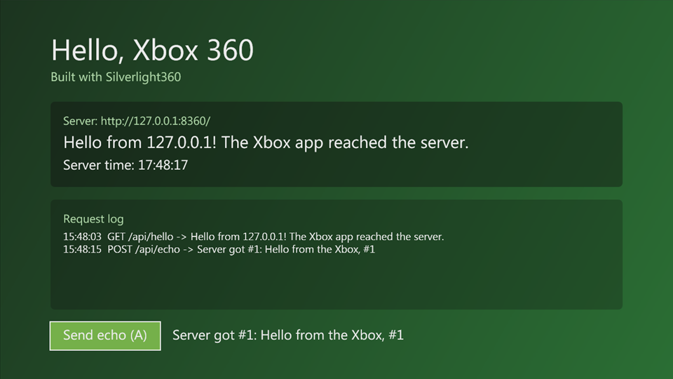
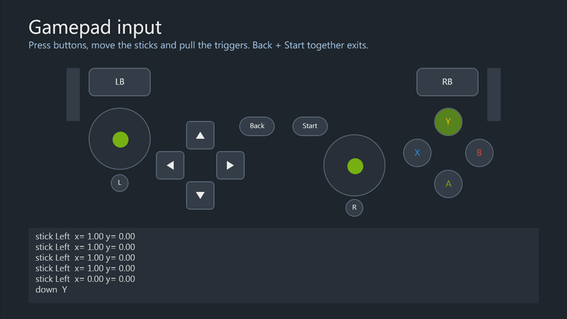
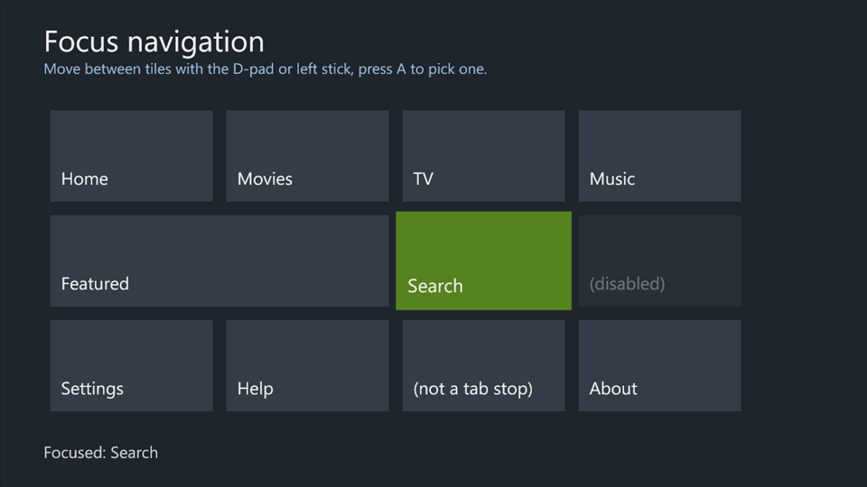
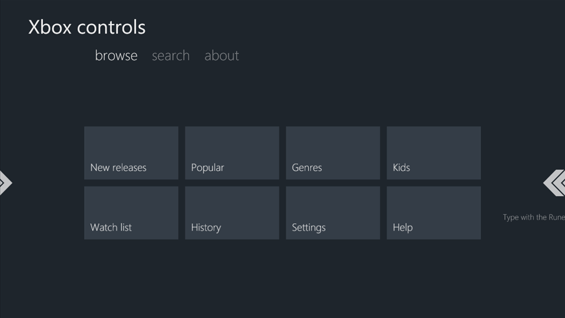
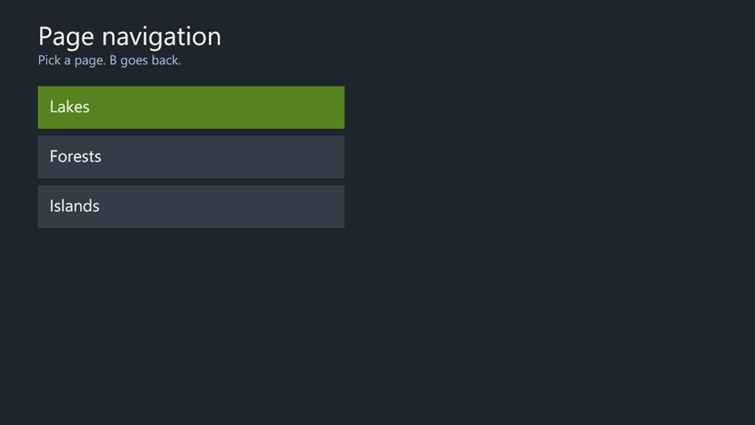
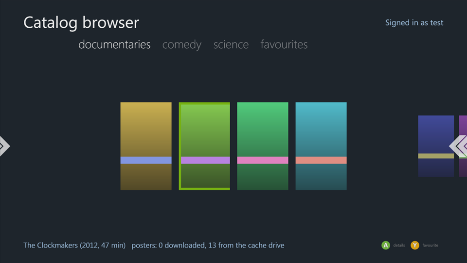
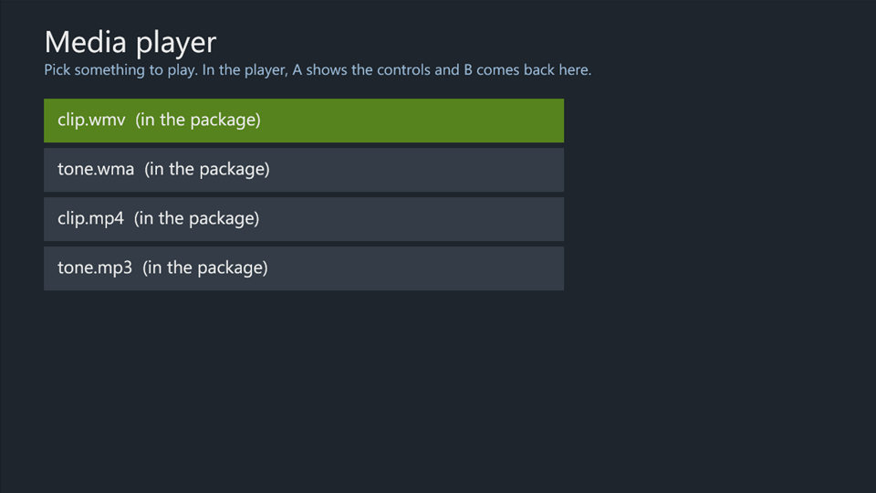
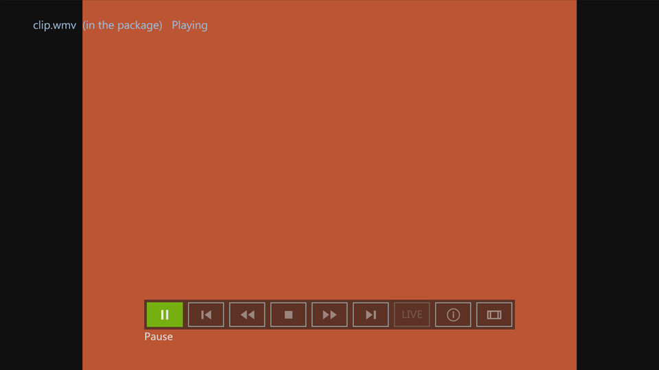
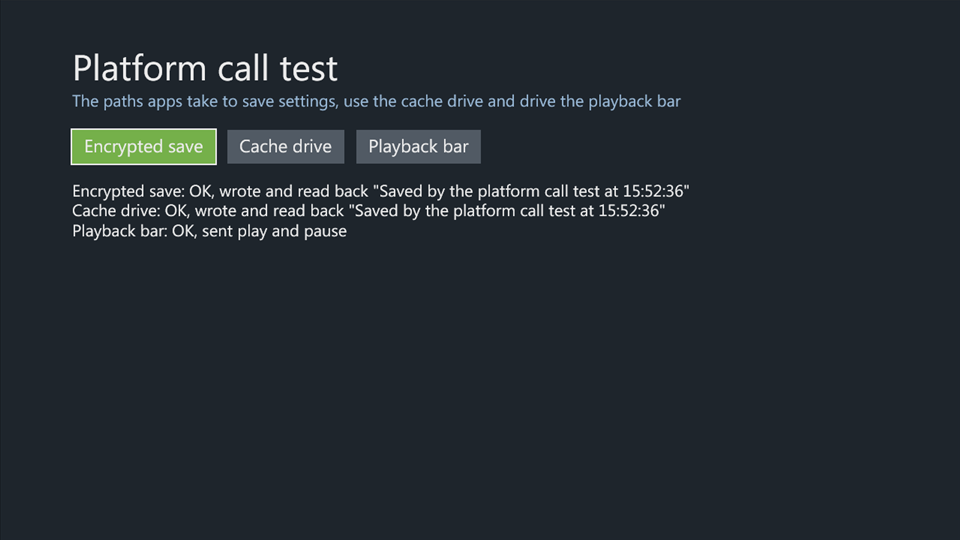

# Silverlight360

An SDK for the Xbox 360 Silverlight platform.

Builds C# and XAML Silverlight apps that run on the Xbox 360 Silverlight
platform (the one Netflix, YouTube, Hulu Plus and the other Xbox 360 apps
used). The output is a folder with a `default.xex` you can launch in the
[xenia-edge](https://github.com/has207/xenia-edge) emulator.

Status: XAML UI, controller input, page navigation, the Xbox controls, HTTP,
storage containers and the cache drive all work under xenia-edge, and WMA,
WMV and MP3 playback with the console's codec module (see
[docs/media.md](docs/media.md)). The PageNavigation sample has also been run
on a console.

**Documentation:** <https://digiex.github.io/Silverlight360/>, also in
[docs/README.md](docs/README.md): guides, the API reference, the samples and
what works in xenia. Visual Studio shows the same API text in IntelliSense
once a runtime profile exists
([Projects and Visual Studio](docs/project-setup.md#intellisense)).

**Samples:** UI samples in [samples/ui](samples/ui) (gamepad input, focus
navigation, Xbox controls, page navigation) and application samples in
[samples/apps](samples/apps) (a catalog browser, a media player). See
[docs/samples.md](docs/samples.md).

## Screenshots

The samples running in xenia-edge.

| | |
|---|---|
|  |  |
| **HelloXbox**: HTTP GET and POST to the test server | **GamepadInput**: buttons, sticks and triggers as they happen |
|  |  |
| **FocusNavigation**: D-pad focus across a grid of tiles | **XboxControls**: `Pivot`, `Rune` and `Legend` |
|  |  |
| **PageNavigation**: pages, transitions and B for back | **CatalogBrowser**: a catalog from a server, posters on the cache drive |
|  |  |
| **MediaPlayer**: media from the package and the server | **MediaPlayer**: WMV playback with `MediaTransport` |
|  | |
| **PlatformCalls**: encrypted saves, the cache drive and the playback bar | |

## How it works

Every Xbox 360 Silverlight app ships its own copy of the platform: the
native host `default.xex` (XamlHost), the CLR (`xcoreclr.dll`), Silverlight
(`agcore.dll`, `npctrl.dll`) and the framework assemblies. XamlHost reads
`AppManifest.xaml` from the app folder, loads the entry assembly it names and
runs the `Application` class.

The SDK reuses that platform:

1. **Runtime profile.** `tools\New-RuntimeProfile.ps1` copies the platform
   out of an extracted app (the *donor*) into `runtime\<name>`: a `package`
   folder every build starts from, and a `reference` folder with the
   framework IL assemblies. The package's `default.xex` has the donor's
   title taken out unless `-KeepTitle` is given
   ([docs/title.md](docs/title.md)).
2. **Compile.** `msbuild\XboxSilverlight.targets` drives the installed
   Silverlight 3 compiler and XAML markup compiler, but resolves framework
   references from the profile instead of desktop Silverlight. Apps get the
   Xbox-only APIs that way, such as `UIElement.GamePadButtonDown` and the
   `Microsoft.Xbox` controls.
3. **Package.** After the build, the targets copy the profile's package,
   the app's assemblies, the generated `AppManifest.xaml`, an
   `XboxAppManifest.xml` and splash screens into `bin\<Configuration>\xbox`.

The app's own assemblies stay plain IL. The Xbox CLR compiles IL itself when
an assembly has no Xenon native image, so no native-image generator is
needed (see [docs/runtime-inventory.md](docs/runtime-inventory.md)). So
that they run compiled rather than interpreted, `Build-XboxApp.ps1` then
makes native images for them with
[XboxNGen](https://github.com/Digiex/Silverlight360-XboxNGen), unless given
`-NoNGen` ([docs/native-images.md](docs/native-images.md)).

## Requirements

Run `.\tools\Configure.ps1` first. It checks each of these, says how to get
any that's missing, downloads XboxNGen and, with XboxNGen's own configure
script, the xenia-edge build it needs, and saves where everything is in
`config.json` (ignored by git), which the other tools read. Run it again
after installing something it reported missing.

| Dependency | Used for | Notes |
|---|---|---|
| Windows | everything | |
| MSBuild 14 or later (Visual Studio 2015 to 2026, or their Build Tools) | builds | MSBuild 14 if it's in its default install folder, else the newest Visual Studio's; `Configure.ps1 -MsBuild` points at another. |
| Silverlight 3 SDK (3.0.40818) | C# + XAML compilation | Its build folder, `MSBuild\Microsoft\Silverlight\v3.0` (the targets and build tasks), is all the build uses: the code compiles against the runtime profile's assemblies, not the SDK's. Microsoft no longer offers it: download `Silverlight3_sdk.zip` from the [Silverlight360 thread on Digiex](https://digiex.net/threads/silverlight360-c-xaml-sdk-for-the-xbox-360.20115/), then install it or copy its build folder ([docs/getting-started.md](docs/getting-started.md#getting-the-silverlight-3-sdk)). The Silverlight 4 and 5 SDKs don't include it, and their build targets don't build these apps. |
| An extracted Xbox 360 Silverlight app | runtime profile | Plex v0.0.0.7 is the default donor; see [docs/getting-started.md](docs/getting-started.md). For example, the [Plex app for Xbox 360](https://digiex.net/threads/plex-app-download-for-xbox-360.14043/) on Digiex, or other apps in its [Xbox 360 apps forum](https://digiex.net/forums/apps-xbox-360.83/). |
| `xextool.exe` (optional) | profile metadata | On PATH or passed to `Configure.ps1 -Xextool`; only used to record build dates. |
| 7-Zip 15.06 or later (optional) | `tools\Expand-GodPackage.ps1` | Only for a `.rar` app download Windows' `tar.exe` can't open; `.zip` downloads need nothing. Older 7-Zips can't open RAR5 archives. |
| Python 3.7 or later (optional) | `samples\TestServer\server.py` | Standard library only; `python` on PATH. |
| [xenia-edge](https://github.com/has207/xenia-edge), a build from 31 October 2026 or later | running apps | See [docs/xenia-status.md](docs/xenia-status.md). Native images need its `silverlight-build` branch, whose [release](https://github.com/jessenic/xenia-edge/releases/tag/silverlight-build-20261105) `Configure.ps1` downloads when it finds no xenia-edge. |
| [XboxNGen](https://github.com/Digiex/Silverlight360-XboxNGen) | native images | Its latest release, which `Configure.ps1` downloads. |
| [xsdk](https://github.com/xenosworks/xsdk) in WSL (optional) | native libraries of the app's own | Its DLL support, in the `dll-modules` branch of [jessenic/xsdk](https://github.com/jessenic/xsdk/tree/dll-modules) until [xenosworks/xsdk#4](https://github.com/xenosworks/xsdk/pull/4) is merged, and its toolchain: `~/xsdk` (or `XSDK` in WSL) and `~/xsdk-gcc` ([docs/samples.md](docs/samples.md), `samples\NativeLibrary`). |
| Silverlight 4 SDK, XNA Game Studio 4 (optional) | IntelliSense | `Install-ApiDocs.ps1` takes more API text from their docs; XNA Game Studio's cover the XNA parts of the Xbox libraries. |

The runtime profile and every package built from it contain Microsoft's and
the donor publisher's binaries. Keep them local; `runtime\` is ignored by
git and nothing in this repository includes them.

## Quick start

From PowerShell in this folder:

```powershell
# 1. Once: check what's installed, and get XboxNGen and xenia-edge.
.\tools\Configure.ps1

# 2. Once: extract the app downloads, if they aren't extracted yet.
.\tools\Expand-GodPackage.ps1 <PlexApp_v0.0.1.7.zip, or a folder of downloads> -Output <apps folder>

# 3. Once: make the default runtime profile from Plex.
.\tools\New-RuntimeProfile.ps1 -DonorApp '<apps folder>\Plex' -Output .\runtime\plex-2015

# 4. Build the sample.
.\tools\Build-XboxApp.ps1 -Project .\samples\HelloXbox\HelloXbox.csproj

# 5. Start the test server the sample talks to (separate window).
python samples\TestServer\server.py

# 6. Run it in the xenia-edge Configure.ps1 set up.
& (.\tools\Config.ps1 Xenia) samples\HelloXbox\bin\Release\xbox\default.xex
```

The sample shows the server's greeting, polls `/api/time` every 5 seconds,
and posts to `/api/echo` when you press A on the controller. The server
prints every request it gets.

## Making an app

A project is an ordinary Silverlight 3 class library project that imports
the SDK targets instead of the Silverlight ones:

```xml
<Project ToolsVersion="4.0" DefaultTargets="Build" xmlns="http://schemas.microsoft.com/developer/msbuild/2003">
  <PropertyGroup>
    <OutputType>Library</OutputType>
    <AssemblyName>MyApp</AssemblyName>
    <RootNamespace>MyApp</RootNamespace>
    <SilverlightAppEntry>MyApp.App</SilverlightAppEntry>
    <OutputPath>bin\$(Configuration)\</OutputPath>
  </PropertyGroup>
  <ItemGroup>
    <Reference Include="mscorlib" />
    <Reference Include="System" />
    <Reference Include="System.Net" />
    <Reference Include="System.Windows" />
    <!-- Optional: Microsoft.Xbox, Microsoft.Xbox.Core, Microsoft.Xbox.Services, ... -->
  </ItemGroup>
  <ItemGroup>
    <ApplicationDefinition Include="App.xaml"><Generator>MSBuild:Compile</Generator></ApplicationDefinition>
    <Page Include="MainPage.xaml"><Generator>MSBuild:Compile</Generator></Page>
    <Compile Include="App.xaml.cs" />
    <Compile Include="MainPage.xaml.cs" />
  </ItemGroup>
  <Import Project="path\to\Silverlight360\msbuild\XboxSilverlight.targets" />
</Project>
```

Properties you can set:

| Property | Default | |
|---|---|---|
| `XboxRuntimeProfile` | `runtime\plex-2015` | Profile to compile against and package with. |
| `XboxPackageDir` | `bin\<Configuration>\xbox\` | Package output. |
| `XboxSplashScreen`, `XboxSplashScreen480` | `templates\*.jpg` | 1280x720 and 640x480 JPEG splash screens. |

The core framework comes with the runtime and isn't listed in the manifest;
every other reference, the Xbox libraries included, is copied and listed in
the generated `AppManifest.xaml` (XAML can't use types from assemblies the
manifest doesn't list).

### What to keep in mind

- **The language is C# 3 and the API is Silverlight 3** plus the Xbox
  additions. `Action<T1,T2>`, `Func<>` and LINQ live in `System.Core`; add
  that reference to use them. XAML can't use `x:String`; use
  `xmlns:sys="clr-namespace:System;assembly=mscorlib"` and `sys:String`.
- **Controller input** arrives as `GamePadButtonDown`/`Up`,
  `GamePadThumbStickMoved` and `GamePadTriggerMoved` on any `UIElement`, and
  bubbles.
- **Networking**: `WebClient` and `HttpWebRequest` go out through the
  console's XHttp stack; in xenia-edge that's the host's WinHTTP. `127.0.0.1`
  is the PC running the emulator.
- **Unhandled exceptions** make XamlHost quit to the dashboard unless you set
  `e.Handled = true` in `Application.UnhandledException`.
- **The title identity is the donor's.** `default.xex` keeps the donor's
  title ID and name (the window shows `574407D1 Plex` for the default
  profile), and with it the donor's save data and settings.
- **No Xbox LIVE.** LIVE security tokens can't be obtained, so anything
  behind XAuth (Plex sign-in, many partner services) fails. Plain HTTP and
  HTTPS work.

## Calling native code

App code can call the kernel and XAM with `DllImport` by ordinal; see
[docs/native-code.md](docs/native-code.md) and [samples/NativeProbe](samples/NativeProbe). It can also call a DLL of
its own in C, built with xsdk's [dll-modules](https://github.com/jessenic/xsdk/tree/dll-modules) branch: see
[samples/NativeLibrary](samples/NativeLibrary) and how to build it in
[docs/samples.md](docs/samples.md#a-native-library-of-the-apps-own).

## Package layout

```
bin\Release\xbox\
  default.xex                  XamlHost, from the profile
  xcoreclr.dll agcore.dll npctrl.dll captions.dll
  mscorlib.dll mscorlib.ni.dll System*.dll Microsoft.Xbox*.dll ...
  Config\machine.config  SystemSounds\  *.ttf  nuisp*  ...
  AppManifest.xaml             generated: entry point and assembly parts
  XboxAppManifest.xml          resolutions and splash screens
  SplashScreenImage.jpg  SplashScreenImage480.jpg
  MyApp.dll                    your code (IL)
```

## Tools

| Script | |
|---|---|
| `tools\Expand-GodPackage.ps1 <downloads> -Output <output>` | Extracts the Games on Demand packages in `.zip`/`.rar` app downloads, folders of them or unpacked ones into `<output>\<package title>`. Handles every SVOD layout xenia does. |
| `tools\extract_stfs_package.py <package> <output>` | Extracts an STFS package (CON/LIVE/PIRS), such as a title update. |
| `tools\Get-AppInventory.ps1 -OutJson <file>` | Lists runtime and framework versions of extracted apps. |
| `tools\Get-DonorAssemblies.ps1 -Root <apps> -OutJson <file>` | Lists the assemblies extracted apps carry that the donor doesn't, with the apps carrying each build; `tools\donor_assemblies_md.py` renders it into [docs/donor-assemblies.md](docs/donor-assemblies.md). |
| `tools\New-RuntimeProfile.ps1 -DonorApp <app> -Output <profile> [-KeepTitle]` | Makes a runtime profile. Its `default.xex` declares no title unless `-KeepTitle` is given ([docs/title.md](docs/title.md)). |
| `tools\Remove-DonorTitle.ps1 <default.xex>` | Takes the donor's title (execution info and title resource) out of an executable; `New-RuntimeProfile.ps1` runs it. |
| `tools\Configure.ps1 [-DonorApp <app>]` | Run first: checks what building and running apps needs, downloads XboxNGen and xenia-edge, and saves where everything is for the other tools (`config.json`; `tools\Config.ps1 <name>` reads it). |
| `tools\Build-XboxApp.ps1 -Project <csproj> [-RuntimeProfile <profile>] [-NoNGen] [-AppOnly]` | Builds and packages a project, then makes native images for its assemblies (`NGen-XboxApp.ps1`); `-NoNGen` leaves them out. `-AppOnly` writes the app's own files alone, with their images, which fit only a package of the same donor app. |
| `tools\NGen-XboxApp.ps1 -Package <package> [-Platform] [-XboxNGen <checkout>]` | Makes native images for a built package with the [XboxNGen](https://github.com/Digiex/Silverlight360-XboxNGen) release and xenia-edge `Configure.ps1` downloaded, or a local XboxNGen checkout. The images are unsigned: they run in xenia-edge and on consoles that run unsigned code only ([docs/native-images.md](docs/native-images.md)). |
| `tools\Test-XboxApp.ps1 -Xex <xex> -Output <dir> -Steps ...` | Runs an app in xenia with scripted controller input and screenshots ([docs/testing.md](docs/testing.md)). |
| `tools\Install-ApiDocs.ps1 [-RuntimeProfile <profile>]` | Writes the IntelliSense files into a profile. |
| `tools\Test-ApiDocs.ps1` | Checks the SDK's documentation files against the API. |
| `tools\Get-PublicApi.ps1 -Assembly <dll> -Output <dir>` | Lists an assembly's public API with documentation IDs. |
| `python tools\new_api_reference.py` | Regenerates the Markdown API reference. |

## xenia-edge support

See [docs/xenia-status.md](docs/xenia-status.md) for what apps need from
xenia-edge and what works.

## Not done

- Little console testing: only the PageNavigation sample has been run on a
  console so far.
- Native images for app code are XboxNGen's and unsigned
  ([docs/native-images.md](docs/native-images.md)), so on a stock retail
  console app code runs interpreted.
- The donor's title ID is kept; changing it needs XamlHost's XEX rebuilt.
- Linux and macOS hosts can build nothing (MSBuild and the Silverlight 3
  SDK are Windows-only) and xenia-edge's XHttp only has a Windows backend.

## Libraries

Class libraries for Silverlight360 apps ([docs/libraries.md](docs/libraries.md)):

- **Silverlight360.Common** (`library\Silverlight360.Common`): `NativeBuffer`, `DebugLog`,
  `DirectionalFocus` and `Screenshot`, which every app and library references
  ([docs/common-library.md](docs/common-library.md)).
- **[Silverlight360.Https](https://github.com/Digiex/Silverlight360.Https)**: HTTP and HTTPS with TLS 1.3 and Mozilla's root
  certificates, libcurl on Mbed TLS, with a drop-in for `WebClient` and `HttpWebRequest`. Its
  documentation is at [digiex.github.io/Silverlight360.Https](https://digiex.github.io/Silverlight360.Https/).

## Built with Silverlight360

[Silverdash360](https://github.com/Digiex/Silverdash360) is a dashboard for the Xbox 360 built
with the SDK, and runs on consoles: an example of a whole app, from calling
XAM and the kernel to releasing it on GitHub. Its documentation is at
[digiex.github.io/Silverdash360](https://digiex.github.io/Silverdash360/).

## Problems, ideas and contributing

[Report a problem](https://github.com/Digiex/Silverlight360/issues/new?template=bug_report.yml)
or [request a feature](https://github.com/Digiex/Silverlight360/issues/new?template=feature_request.yml)
on GitHub Issues; look through the [open issues](https://github.com/Digiex/Silverlight360/issues)
first, and see [docs/issues.md](docs/issues.md) for what helps.

Contributions and pull requests are welcome: fixes, tools, API
documentation, guides, samples and console testing. See
[CONTRIBUTING.md](CONTRIBUTING.md).

## License

Silverlight360 is licensed under the
[PolyForm Noncommercial License 1.0.0](https://polyformproject.org/licenses/noncommercial/1.0.0)
with one additional condition; see [LICENSE.md](LICENSE.md). In short:

- Noncommercial use only: personal, hobby, research and other
  noncommercial projects.
- Any project made with Silverlight360, including apps built with it and
  work based on its samples, must include a visible reference to
  https://github.com/Digiex/Silverlight360.
- Copies of Silverlight360 itself must keep the license and its
  `Required Notice` line.

The license covers this repository only, not the Microsoft and third-party
binaries a runtime profile copies out of an Xbox 360 app.

## Trademarks

Microsoft, Xbox, Xbox 360, Xbox LIVE, Silverlight, Windows, Visual Studio
and XNA are trademarks or registered trademarks of Microsoft Corporation.
Netflix, YouTube, Hulu, Plex and the other app and service names mentioned
here are trademarks of their respective owners. They are used only to
describe what this project works with. Silverlight360 is an independent
project, not affiliated with, endorsed or sponsored by Microsoft or any of
these companies.
