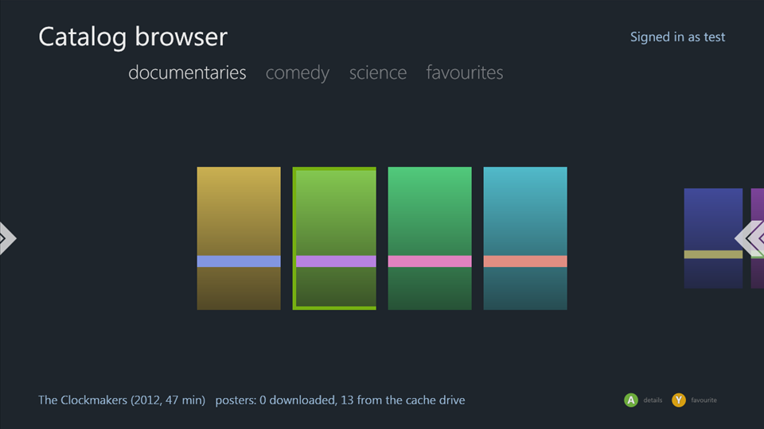

# Silverlight360 documentation

Silverlight360 builds C# and XAML Silverlight apps for the Xbox 360 Silverlight platform, the one Netflix, YouTube and the other Xbox 360 apps used. The output is a package with a `default.xex` you can run in the [xenia-edge](https://github.com/has207/xenia-edge) emulator.

The code, samples and tools are at [github.com/Digiex/Silverlight360](https://github.com/Digiex/Silverlight360).

Guides:

| | |
|---|---|
| [Getting started](getting-started.md) | Install the tools, make a runtime profile, build and run a sample. |
| [Projects and Visual Studio](project-setup.md) | The project file, references, build properties, packaging, IntelliSense. |
| [App model](app-model.md) | Startup, `XboxApplicationFrame`, pages and navigation, back and exit, the TV screen. |
| [Input and focus](input-and-focus.md) | Controller events, focus, moving focus with the D-pad, the Legend, media remotes. |
| [Xbox controls](controls.md) | Pivot, Rune, Legend, MediaTransport, ContinuousList, transitions, speech. |
| [Networking](networking.md) | `WebClient` and `HttpWebRequest`, cross-domain policy, what needs Xbox LIVE. |
| [Storage](storage.md) | Saving settings in a storage container, the cache drive. |
| [Media](media.md) | `MediaElement`, `MediaTransport`, Smooth Streaming, DRM. |
| [Gamer services](gamer-services.md) | Signed-in gamers, the Guide, presence, threading. |
| [Native code](native-code.md) | Calling the kernel and XAM with `DllImport`. |
| [Testing in xenia](testing.md) | Running an app with scripted controller input and screenshots. |
| [Status under xenia](xenia-status.md) | What works in the emulator today and what doesn't. |

Reference:

- [API reference](reference/README.md): the Xbox libraries and the Xbox additions to Silverlight, one page per namespace. The same text appears in Visual Studio's IntelliSense.
- [Samples](samples.md): what each sample shows and how it was tested.
- [Runtime inventory](runtime-inventory.md): the platform versions found in the shipped apps.

Everything here comes from running apps in the [xenia-edge](https://github.com/has207/xenia-edge) emulator and from reading the platform's own assemblies. Of the samples, only PageNavigation has been run on a console so far.
