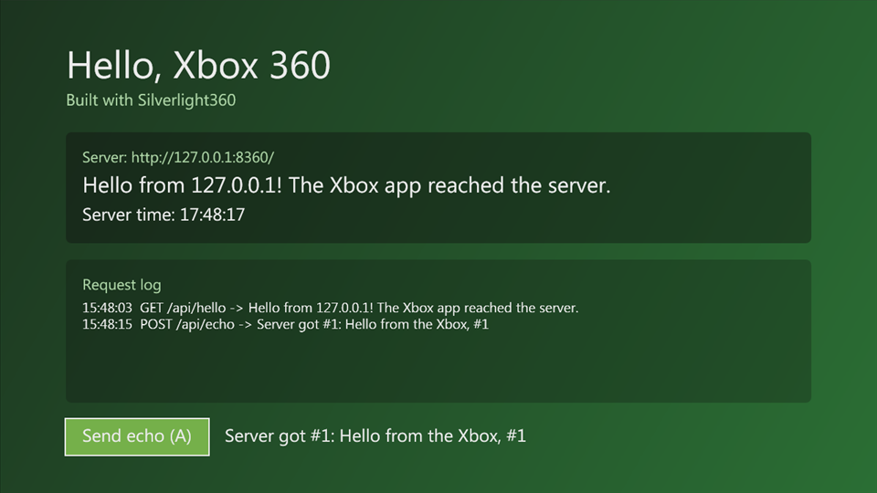
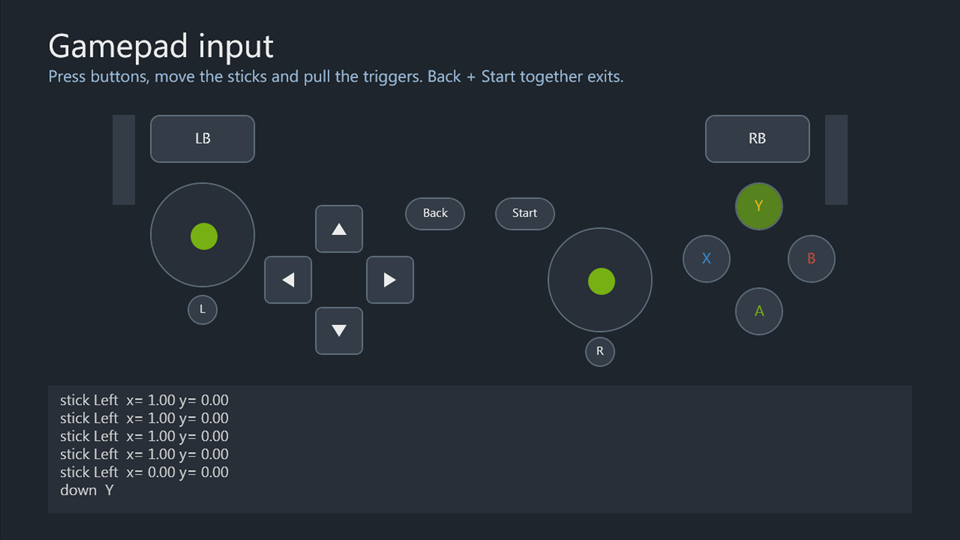
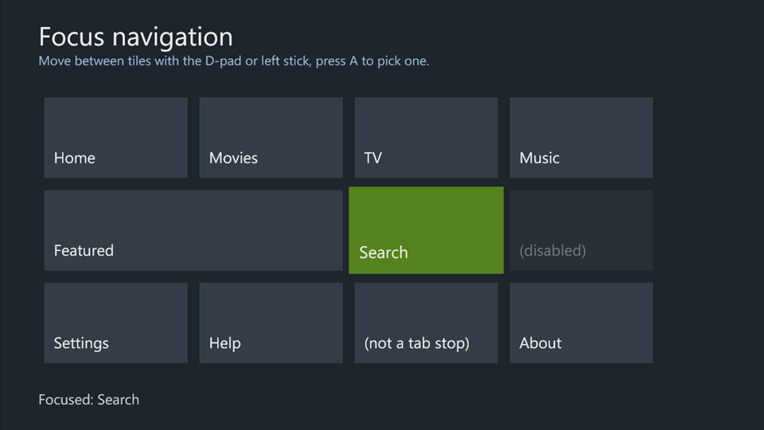
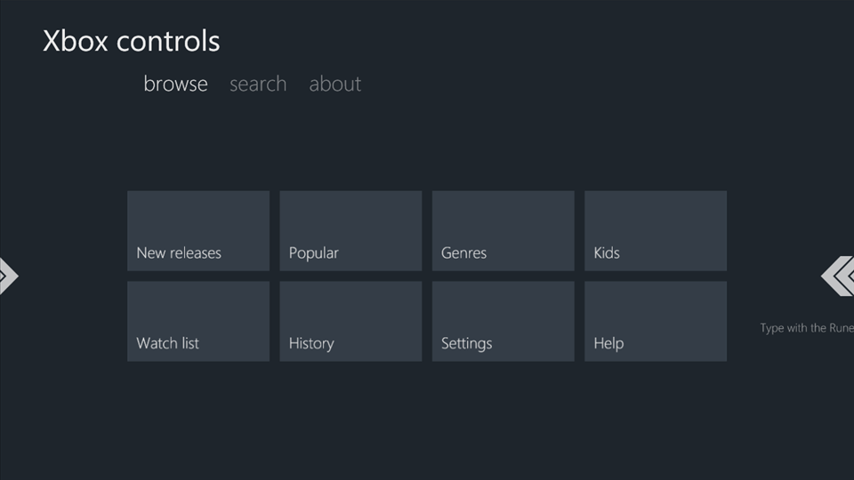
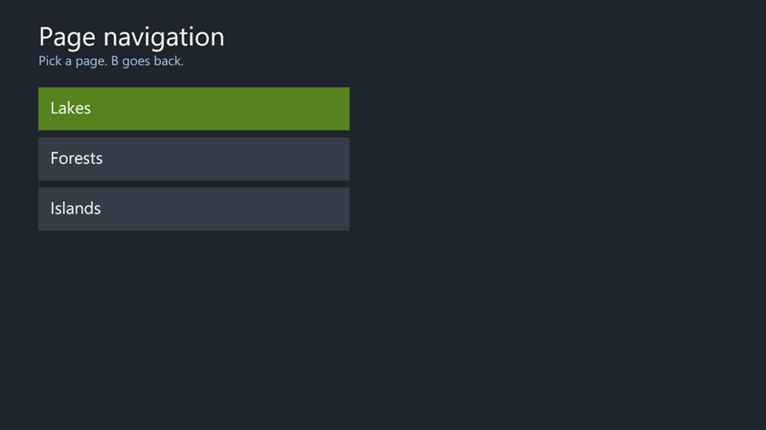
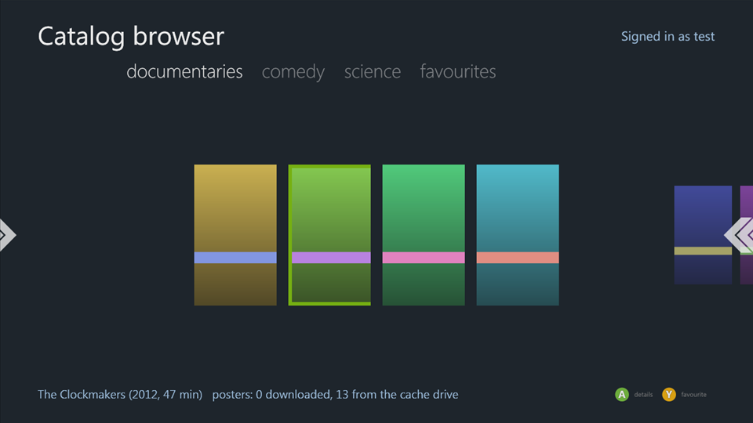
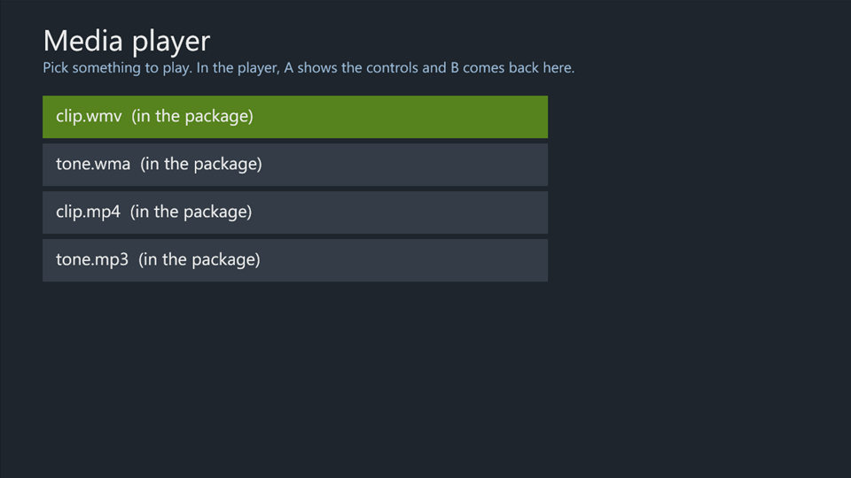
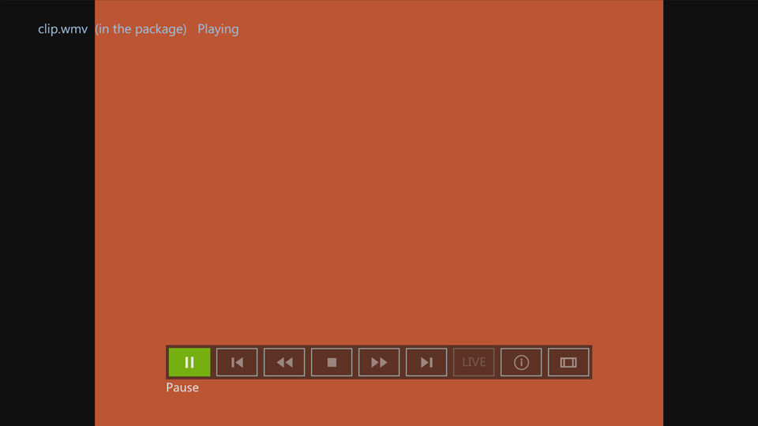
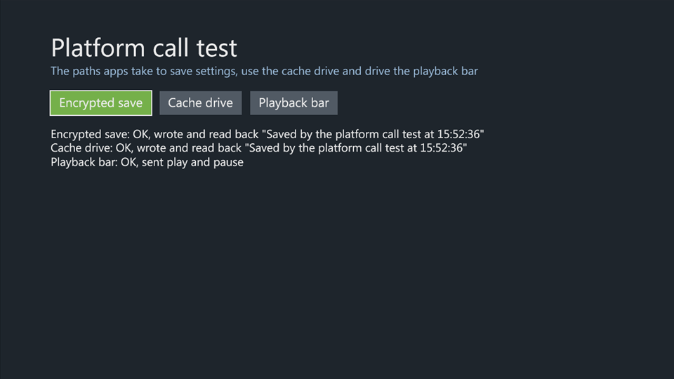

# Samples

Build any sample with `tools\Build-XboxApp.ps1 -Project <csproj>` and run its `bin\Release\xbox\default.xex` in xenia. Code shared by several samples is in `samples\Common`: `ServerClient` (HTTP), `DirectionalFocus` (D-pad focus movement) and `DebugLog` (debug output to xenia's log; see [Testing](testing.md#debug-output)).

## UI samples

| Sample | Shows | Tested in xenia |
|---|---|---|
| [ui\GamepadInput](../samples/ui/GamepadInput) | Every controller event live: button down/up, both sticks, both triggers, how bubbling and `Handled` work, `Application.Shutdown` on Back+Start. | Y, X, D-pad, RB, left stick and left trigger events shown live. |
| [ui\FocusNavigation](../samples/ui/FocusNavigation) | Focus on a grid of tiles: a focused-state template, A clicking the focused `Button`, D-pad and stick movement with `DirectionalFocus`, disabled and non-tab-stop controls skipped, unused buttons bubbling to the page. | D-pad and stick moved focus across the grid, including onto the wide tile; A clicked. |
| [ui\XboxControls](../samples/ui/XboxControls) | `Pivot` sections switched with LB/RB and built-in grid navigation, a `Rune` for text entry, a `Legend` following the focused control. | Focus moved by the PivotItem; RB switched sections; the Rune typed "bc"; the Legend changed with focus. |
| [ui\PageNavigation](../samples/ui/PageNavigation) | `XboxApplicationFrame` with `XboxApplicationPage`s, query-string parameters, staggered transitions, B for back, going back to the first page. | Opened a page, went one deeper, B went back; four pages deep, "Back to the start" unwound to the home page and the home buttons still opened pages. |

## Application samples

| Sample | Shows | Tested in xenia |
|---|---|---|
| [apps\CatalogBrowser](../samples/apps/CatalogBrowser) | A streaming-style catalog: an XML catalog from a server, a `Pivot` per category built in code, posters cached on the cache drive, a detail page, favourites saved in a storage container (Y toggles them), the signed-in gamertag, a `Legend`. Needs the test server, and a runtime profile with the title for the favourites ([The app's title](title.md)). | Catalog and posters loaded; gamertag shown; Y added a favourite and the detail page saw it; posters came from the cache drive on later loads; B went back; RB switched categories. |
| [apps\MediaPlayer](../samples/apps/MediaPlayer) | A media list and a player page with `MediaTransport` around a `MediaElement`: `MediaAssetId`, focus, the `Back` event, stopping on leaving, state changes and failures logged with `DebugLog`. Lists files packaged in its `Media` folder (played from a URI relative to the XAP) and files from the test server's `samples\TestServer\media`. | List, player page, transport bar and back work; WMA plays from the package and the server. With the codec loader and the console's codec module (see [Media](media.md)), packaged WMV and MP3 play too; MP4 plays with a garbled picture. |

## Earlier samples

| Sample | Shows |
|---|---|
| [HelloXbox](../samples/HelloXbox) | The smallest app: XAML, A on the controller, HTTP GET and POST to the test server, a `DebugLog` line at startup. |
| [NativeProbe](../samples/NativeProbe) | `DllImport` into xam and the kernel by ordinal, including a structure through a pinned buffer. |
| [PlatformCalls](../samples/PlatformCalls) | A storage container, the cache drive and `MediaTransport` commands, each reporting OK or the error. Written to test the xenia fixes for them. Build it on a runtime profile with the title ([The app's title](title.md)). |

## A native library of the app's own

[NativeLibrary](../samples/NativeLibrary) calls into `testlib.xex`, a DLL in C that ships in the app's package, with
`DllImport` by ordinal: 32- and 64-bit arguments and results, a pinned buffer the DLL reads and writes, and state the
DLL keeps between calls. Then it asks the kernel for the same module with `XexLoadImage`, `XexGetModuleHandle` and
`XexGetProcedureAddress`. It passes all 8 checks in xenia-edge and on a console (2.0.17559) that runs unsigned code.

The DLL is built with [xsdk](https://github.com/xenosworks/xsdk), and needs its DLL support (`elf2xex.py --dll`), which
is in the `dll-modules` branch of [jessenic/xsdk](https://github.com/jessenic/xsdk/tree/dll-modules) until
[xenosworks/xsdk#4](https://github.com/xenosworks/xsdk/pull/4) is merged. Build xsdk's toolchain as its own docs say
(in WSL, `~/xsdk-gcc`), then:

```bash
# In WSL: writes samples/NativeLibrary/testlib.xex, which the project packages. XSDK is the dll-modules checkout
# (default ~/xsdk), TOOLCHAIN the toolchain's prefix (default ~/xsdk-gcc/bin/powerpc-xsdk-elf-).
git clone -b dll-modules https://github.com/jessenic/xsdk ~/xsdk
XSDK=~/xsdk bash samples/NativeLibrary/native/build.sh
```

```powershell
# Then the app, as any sample.
.\tools\Build-XboxApp.ps1 -Project .\samples\NativeLibrary\NativeLibrary.csproj
```

What a DLL of your own needs, to load on a console as well as in xenia:

- **A load address that's free on the console.** `native/testlib.ld` links it at 0x8F000000 and `build.sh` gives
  elf2xex the same `--base`. A console running a Silverlight app has 0x8A000000, 0x8C000000 and 0x8E000000 taken, and
  there the module can't load. xenia has them free, so it doesn't show. A module that doesn't load becomes a call
  through a null pointer at its first `DllImport`, which took the console down.
- **`XexLoadImage` asked as the CLR asks:** with the path the CLR loaded it by (`GAME:\` before its name) and flags 9,
  a DLL of the title's process. A title's request without the title bit (0x1) is refused with
  STATUS_ACCESS_DENIED on a console; xenia lets it through.

## Apps built with Silverlight360

| App | Shows |
|---|---|
| [Silverdash360](https://github.com/Digiex/Silverdash360) ([documentation](https://digiex.github.io/Silverdash360/)) | A whole app that runs on consoles: a dashboard listing the console's games and apps with `DllImport` into XAM and the kernel, a virtualized grid for thousands of titles, Marketplace art over its own socket HTTP client, DLNA media servers, an FTP server, and updates from GitHub over HTTPS. Its releases are app-only builds ([Handing out an app](project-setup.md#handing-out-an-app)), and it has a debug server for testing on a console without a development kit. |

## Screenshots

All taken in xenia-edge.

| | |
|---|---|
|  |  |
| **HelloXbox** | **GamepadInput** |
|  |  |
| **FocusNavigation** | **XboxControls** |
|  |  |
| **PageNavigation** | **CatalogBrowser** |
|  |  |
| **MediaPlayer**, the list | **MediaPlayer**, a WMV playing |
|  | |
| **PlatformCalls** | |
